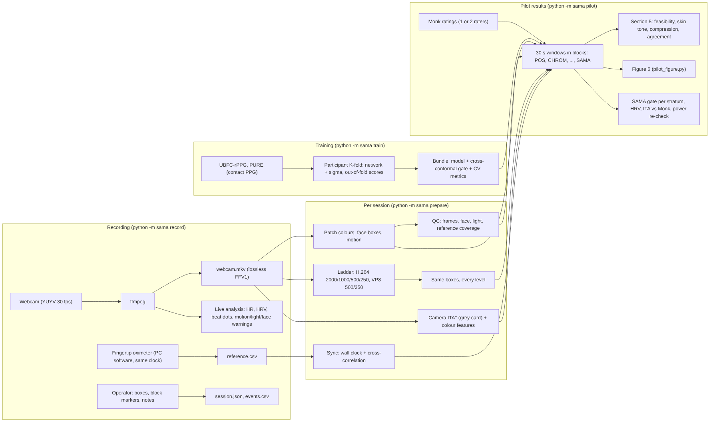

# The SAMA pipeline

| Stage | Command | Code | Writes |
|---|---|---|---|
| Configuration | `python -m sama config` | `sama/config.py`, `configs/sama.yaml` | (prints) |
| Recording | `python -m sama record --participant P01` | `sama/recorder.py`, `sama/live.py`, `app/` | `pilot_data/sessions/P01/{webcam.mkv, session.json, events.csv, live_readings.csv}` |
| Per-session preparation | `python -m sama prepare` | `sama/pilot.py: prepare` | `sessions/P01/ladder/*`, `sessions/P01/derived/{signals_*.npz, ita_camera.json, ita_features.json, sync.json, qc.json}` |
| Quality table | `python -m sama qc` | | (prints) |
| Dataset inventory | `python -m sama datasets` | `sama/datasets.py` | (prints what is on disk, per dataset) |
| Training on real data | `python -m sama train` | `sama/realtrain.py`, `sama/datasets.py`, `sama/loaders.py`, `sama/pilotitems.py` | `models/sama_real/{sama_net.npz, sama_model.json, cv_metrics.json, cv_predictions.csv, config_used.yaml}` |
| Cross-dataset test | `python -m sama test --datasets MMPD,iBVP` | `sama/realtrain.py` (`evaluate`) | `results/pilot/eval/{eval_metrics.json, eval_predictions.csv, eval_report.md}` |
| Skin-tone model | `python -m sama train-ita --target monk` | `sama/ita_model.py` | `models/ita_model/ita_model.json` |
| Pilot results | `python -m sama pilot` | `sama/pilot.py: results`, `sama/pilotreport.py`, `scripts/pilot_figure.py` | `results/pilot/*` |
| Proposal | `python proposal/build_proposal.py` | | `proposal/build/*.pdf, *.docx` |

## Data flow and design choices

- **Video is never decoded with OpenCV** (its bundled FFmpeg crashed on UBFC-rPPG files, I-36). `sama/video.py` uses the ffmpeg command-line tools. OpenCV is optional and used only for the Haar face detector.
- **No frame is kept.** Each video is reduced once to per-frame measurements: 30 skin-patch colour means (skin pixels only), face box, skin fraction, motion index, brightness. Every compression level is measured on the boxes tracked on the lossless video, so differences between levels are due to the codec alone.
- **Windows respect protocol blocks** (`signal.windows_within_blocks`), and `pilot.exclude_blocks_from_accuracy` keeps the card-holding and motion-check blocks out of accuracy.
- **Synchronisation** starts from the PC clock and is refined by cross-correlating the camera pulse with the oximeter wave in each 30 s window (two passes: wide, then ±0.3 s around the median). The robust spread of the per-window lags is reported as the synchronisation error.
- **Skin tone** comes from the source selected by `ita.source`. Camera ITA° uses von Kries white balance against a grey or white card (or a colour-correction matrix from a chart), skin pixels from the cheeks, and a median over frames; flags mark clipping, instability and implausible values.
- **SAMA on real data** is trained by participant-level K-fold cross-validation; the gate is calibrated by cross-conformal scores; the final bundle stores the configuration snapshot, the CV metrics and the list of training recordings. With `pilot.role = test_only` no pilot participant touches training or calibration.
- **Provenance**: every output is stamped with `project.provenance_label`; the proposal build refuses SYNTHETIC inputs unless asked for a watermarked test build.
